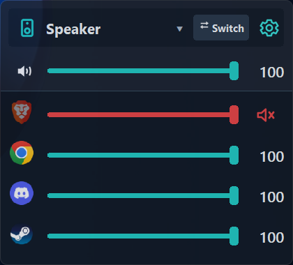
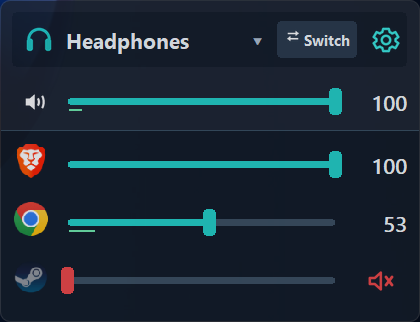
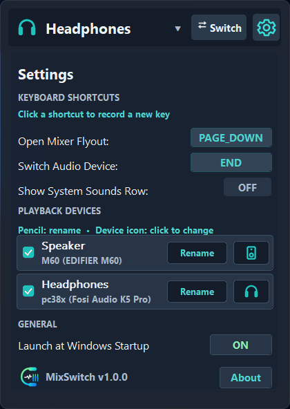
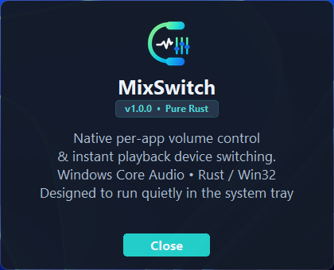

# MixSwitch

**A compact native Windows audio mixer and playback-device switcher, written in Rust.**

MixSwitch runs from the system tray and lets you control the Windows master volume and per-application volume sessions, mute individual apps, and switch between selected audio output devices.

> **Release:** v1.0.0 (public version). The `v4.2` label found in archived development notes refers to an internal UI iteration, not a second public product version.

## Features

- Compact tray flyout, toggled using the configured global hotkey (default `Page Down`).
- Master volume and per-app volume sliders, with live level indicators.
- Per-app mute and unmute, with clear visual state.
- Switch between selected playback devices (default hotkey `End`).
- Optional Windows startup registration; no administrator permission required.
- Rename playback devices within MixSwitch (local aliases; Windows device names remain unchanged).
- Configure hotkeys and device icons in the app settings.
- Windows 11–style dark appearance; embedded icon and UI assets.

## Screenshots

### Volume Mixer

<p align="center">
  
  
</p>

### Settings & About

<p align="center">
  
  
</p>

## Install (Windows x64)

1. Open **Releases** on this repository and download **MixSwitch.exe** from the latest published release.
2. Save it somewhere permanent (for example, a user-writable apps folder). No installer or extra app files are required for the bundled assets.
3. Double-click **MixSwitch.exe**, then find its icon in the system tray.
4. Choose whether to launch MixSwitch with Windows. You can change this later in **Settings**.

The executable is not currently digitally signed. Windows SmartScreen may warn about unfamiliar downloads. Verify the release and its SHA-256 checksum, and do not bypass security prompts if you do not trust the file or its source.

**Requirements:** Windows x64. Windows 11 is the primary design target; Windows 10 and differing hardware/DPI setups require additional user testing.

## Build from source

Install [Rust](https://rustup.rs/) and the Visual Studio C++ Build Tools (MSVC). Clone the repository and run:

```powershell
cargo build --release --locked --target x86_64-pc-windows-msvc
```

Output: `target/x86_64-pc-windows-msvc/release/mixswitch.exe`. Or run `PACKAGE_RELEASE.bat` to copy `MixSwitch.exe` and `SHA256SUMS.txt` into `dist/`.

Builds also run in GitHub Actions on the `main` branch. Version tags such as `v1.0.0` produce a **draft** GitHub Release, so the maintainer can test the binary before manually publishing it.

## Known notes

- The mixer uses a layered-window opacity treatment; it can also dim foreground elements. It is not a full independent-background Acrylic implementation.
- Recognition of apps using WebView2 (including WhatsApp) is best effort and may vary by app version.
- **License:** MIT for the original project code and materials the project owner is authorized to license (see [LICENSE](LICENSE)). Third-party brand names, logos, and trademarks are not licensed by the MIT grant; review any bundled third-party artwork before public distribution.
- Brand marks and names belong to their respective owners; MixSwitch is an independent project.

**Arabic maintainer guide:** [README_AR.md](README_AR.md)  
**Pre-release checklist:** [RELEASE_CHECKLIST_AR.md](RELEASE_CHECKLIST_AR.md)
